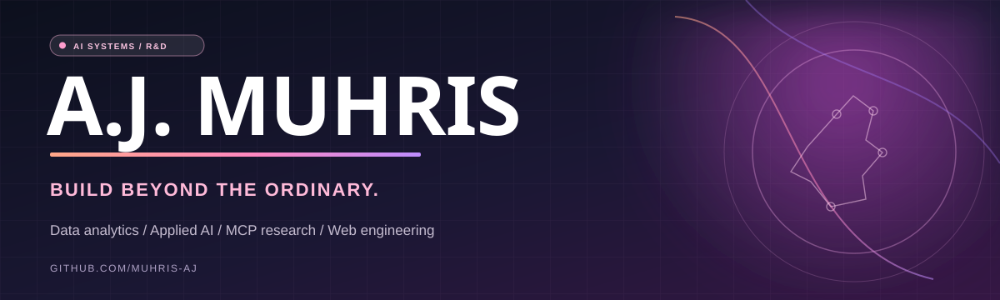

  

<h1 align="center">A.J. Muhris · MUHRIS-AJ</h1>

  BICT undergraduate · Data Science & Applied AI · Software engineering

  
  
  

---

### Building useful systems, one experiment at a time.

I’m exploring practical ways to combine **Python, data analysis, software engineering, and agent-assisted research**. My focus is understanding a problem, finding reliable sources, building a testable prototype, and documenting what works.

**Current interests:** Applied AI · Multi-agent architecture · Model Context Protocol (MCP) · Data analytics · Research tooling

### Featured work

| Project | Focus | Status |
|:--|:--|:--|
| [M23-AI](https://github.com/MUHRIS-AJ/M23-AI) | AI workspace and product experiments | Public source |
| [Tamil–English Evaluator](https://github.com/MUHRIS-AJ/AI_Tamil_English_Evaluator) | Bilingual evaluation workflows | Public source |
| [Sales Business Insights](https://github.com/MUHRIS-AJ/1.-Sales-Business-Insights-Dashboard-DA-Power-BI-) | Analysis, dashboards and reporting | Public source |
| [Customer Segmentation](https://github.com/MUHRIS-AJ/2.-Customer-Segmentation-Unsupervised-ML-) | Unsupervised machine-learning experiments | Public source |
| [Churn Prediction](https://github.com/MUHRIS-AJ/3.-Churn-Prediction-Simple-Classification-) | Classification and evaluation | Public source |
| [ResearchGuard](https://github.com/MUHRIS-AJ/muhris-portfolio/tree/main/labs/researchguard) | Read-only MCP prototype for Crossref citation metadata | Prototype |

### Agentic AI lab

The following are **planned concepts**, not completed apps:

`ResearchGuard` · `TenderPilot` · `ZeroWaste` · `EarthWatch` · `GrantScout` · `AccessMap` · `RecallRadar` · `TradeBridge`

Read the [project backlog and measurable MVP targets](https://github.com/MUHRIS-AJ/muhris-portfolio/blob/main/docs/AGENT_PROJECTS.md).

### Tools and technologies

  
  
  
  
  
  

### My development workflow

`Research` → `Architecture` → `Implementation` → `Testing` → `Security review` → `Documentation` → `Release`

I distinguish **planned ideas**, **working prototypes**, and **deployed applications**. No inflated experience, stars, statistics, or credential claims.

<strong><a href="https://muhris-ai-lab.vercel.app">Enter MUHRIS AI LAB →</a></strong>

